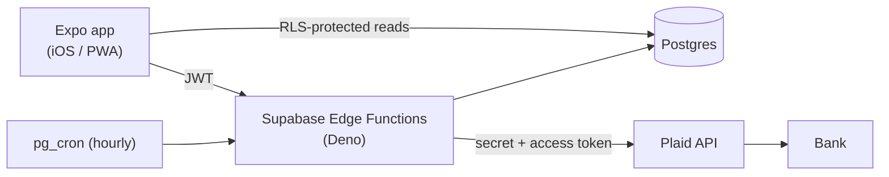

# ExpenseTracker

Personal expense tracker that connects to my bank accounts, pulls in real transaction data, and allows me to categorize them into my own categories. It is built with React Native (Expo) and runs on my Iphone as an installable web app. Backend is Supabase, and Plaid is used to get bank data.

This app was built to learn mobile development as well as using AI in my workflow.

## Features

- **Link real banks** through Plaid Link, including OAuth banks like Bank of America
- **Automatic hourly sync** using a Postgres cron job and Plaid's `/transactions/sync` cursor API
- **Custom categories**: assign any transaction to a category and see a running total per category
- **Split transactions**: break one charge into parts and categorize each part separately. Splits can be split again, and undoing a split restores the original.
- **Account management**: hide individual accounts, or disconnect a bank entirely. (this revokes Plaid access and deletes the stored data)
- **In-app consent screen** shown before any bank is linked

## Architecture



The phone is a thin client. Plaid secrets or bank access tokens are never stored here. All bank logic runs in the Edge Functions:

| Function | Purpose |
|---|---|
| `create-link-token` | Starts a Plaid Link session for the signed-in user |
| `exchange-public-token` | Swaps Link's one-time public token for an access token, then encrypts and stores it |
| `sync-transactions` | On-demand sync for the current user |
| `cron-sync` | Hourly sync for all users, triggered by `pg_cron` + `pg_net` |
| `disconnect-bank` | Calls Plaid `/item/remove` and deletes the item, cascading to its accounts and transactions |


## Security Model

- **Access tokens never leave the server.** The app only ever handles Plaid's short-lived public token.
- **Encrypted at rest.** Access tokens are encrypted with AES-GCM before they're written to the database. The key lives in Supabase secrets, separate from the data.
- **Row Level Security** on every table. Each user can read and write only their own rows. The Supabase key in `mobile/lib/supabase.js` is the *publishable* key, which is meant to be public. RLS is what actually protects the data.
- **Cron authentication.** The scheduled job authenticates with a shared secret stored in Supabase Vault, not hard-coded in SQL.
- **Read-only bank access.** Plaid's Transactions product cannot move money.
- **Session storage.** On iOS the auth session is stored in the Keychain via `expo-secure-store`.

## Sync Correctness

- `external_id` (Plaid's transaction ID) is the idempotency key. Sync **upserts** on it, so pulling the same transaction twice never creates a duplicate.
- Sync applies Plaid's `added`, `modified`, and `removed` lists, follows `has_more`, and saves the cursor only *after* a page's writes succeed. If a run fails partway, the next run resumes from the last good page.
- Sync updates the bank-derived fields but never overwrites `category_id`, which is the user's own label.

## Data Model

- `plaid_items`: one row per linked bank (encrypted access token, sync cursor)
- `accounts`: the accounts under each item (type, balance, `hidden` flag)
- `transactions`: amount, date, description, my `category_id`, and a self-referencing `parent_id` for splits
- `categories`: user-defined labels

## Tech Stack

| Layer | Tech |
|---|---|
| App | React Native 0.81, Expo SDK 54, React Navigation, `react-plaid-link` (web) |
| Backend | Supabase Edge Functions (Deno / TypeScript) |
| Database | Supabase Postgres, RLS, `pg_cron`, `pg_net`, Vault |
| Bank data | Plaid (Transactions) |
| Hosting | Netlify (PWA via `expo export -p web`), Supabase |

## Project Structure

```
mobile/                 Expo app
  screens/              One file per screen; LinkBank.web.js is the web-specific Link flow
  context/              Auth and transaction state (React Context)
  lib/                  Supabase client, SecureStore adapter, cross-platform dialogs
  public/               Netlify _redirects and static fonts
backend/supabase/
  functions/            Edge Functions
  functions/_shared/    CORS wrapper, AES-GCM helpers
```
